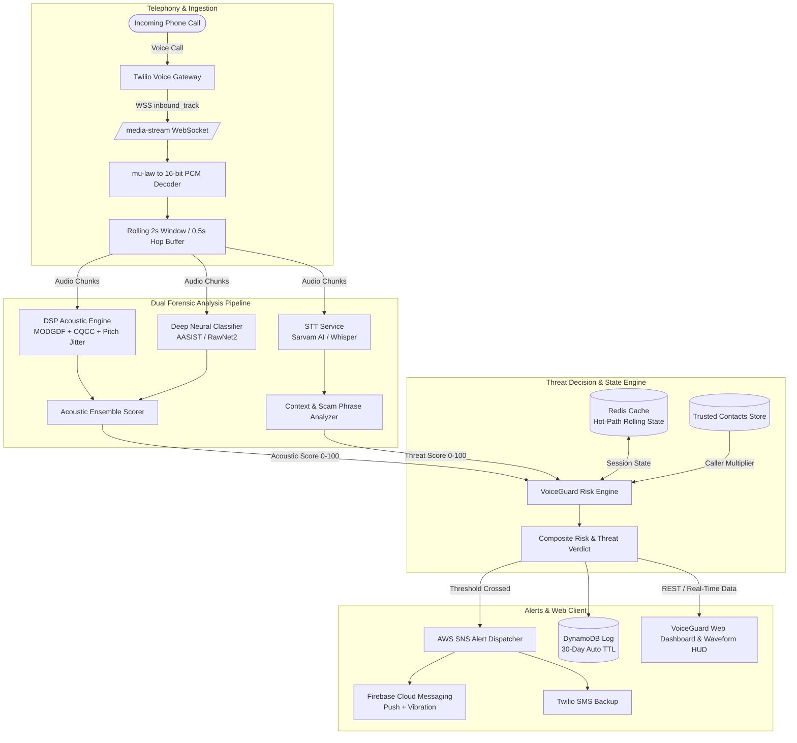

# VoiceGuard 🛡️ — Real-Time AI Voice Clone & Deepfake Scam Call Detector

<div align="center">

[](https://www.python.org/)
[](https://fastapi.tiangolo.com/)
[](https://pytorch.org/)
[](https://www.twilio.com/)
[](https://redis.io/)
[](https://aws.amazon.com/)
[](https://www.docker.com/)
[](https://opensource.org/licenses/MIT)

**Intelligent Real-Time Audio Defense against Deepfake Voice Impersonation, Synthetic Vocoder Spoofing, and Social Engineering Fraud.**

[Key Features](#-key-features) • [System Architecture](#-system-architecture) • [Tech Stack](#-tech-stack) • [Installation & Setup](#-installation--setup) • [Interactive Web Dashboard](#-interactive-web-dashboard--forensic-analyzer) • [API Documentation](#-api-documentation) • [Detection Pipeline & Mathematics](#-detection-pipeline--mathematics) • [Contributors](#-contributors)

</div>

---

## 📌 Problem Statement & Context (SIH PS 26104)

With the democratization of generative AI, text-to-speech (TTS), and voice conversion engines (ElevenLabs, Tortoise, XTTS, Sarvam AI), malicious actors can synthesize a hyper-realistic clone of any human voice using as little as **3 seconds of reference audio**.

These cloned voices power devastating social engineering attacks:
- **Banking & OTP Harvesting:** Callers impersonating bank fraud departments claiming an unauthorized transaction and coercing victims to surrender one-time passwords (OTPs) and PINs.
- **Family Emergency & Kidnapping Scams:** Cloned voices of children or relatives claiming arrest or medical emergencies, demanding immediate ransom via UPI/wire transfers.
- **CEO Fraud & Business Email Compromise (BEC):** Spoofed executive voices authorizing urgent wire transfers or payroll releases.

**VoiceGuard** is an end-to-end cyber-defense platform that operates during active phone calls. By processing caller audio in real-time through sub-50ms digital signal processing (DSP), neural anti-spoofing models, and social engineering context analysis, VoiceGuard calculates a rolling composite threat score and alerts targets before financial harm occurs.

---

## 🚀 Key Features

### 1. Real-Time Telephony Media Stream Ingestion
- **Twilio Voice Bridge & Media Streams:** Ingests live telephone audio via WebSockets (`wss://<host>/media-stream`) by subscribing exclusively to `track="inbound_track"`. This isolates the caller's speech, cuts network bandwidth and compute overhead by 50%, and safeguards caller privacy.
- **Stream Decoding & Jitter Buffering:** Decodes base64-encoded $\mu$-law 8 kHz audio frames into linear 16-bit PCM audio, accumulating frames into rolling 2-second windows with 0.5-second overlap.

### 2. Multi-Feature Acoustic Forensic Engine (Sub-50ms DSP)
Synthetic vocoders leave distinct mathematical footprints in phase coherence and micro-prosody that are invisible to human ears:
- **Modified Group Delay Function (MODGDF):** Analyzes STFT phase spectra to detect unnatural phase discontinuities and spectral smoothing typical of neural synthesis.
- **Constant-Q Cepstral Coefficients (CQCC):** Applies geometrically spaced frequency bins and Discrete Cosine Transform (DCT) to capture unnatural spectral envelope flux.
- **Fast Pitch Jitter & Shimmer Tracker:** Features a specialized autocorrelation-based pitch tracker operating in **<5ms per chunk** (nearly 1,000x faster than deep models on CPU) alongside CREPE deep pitch tracking to measure cycle-to-cycle F0 perturbation and synthetic monotonic flatlines.
- **Silero Voice Activity Detection (VAD):** Evaluates pauses, breathing gaps, and speech rate anomalies to distinguish human conversation rhythm from pre-rendered or conversational AI audio pipelines.

### 3. Deep Anti-Spoofing Neural Inference
- Integration with pretrained and fine-tuned **AASIST** (Audio Anti-Spoofing using Integrated Spectro-Temporal Graph Attention) and **RawNet2** architectures trained on the **ASVspoof 2019/2021** datasets and synthesized regional vocoder benchmarks (including Sarvam AI TTS).

### 4. Natural Language Threat & Social Engineering Intelligence
- **Real-Time Speech-to-Text (STT):** Integrates Sarvam AI STT (optimized for Indian accents and multilingual contexts) with a Whisper fallback engine.
- **Multi-Tier Heuristic & Embedding Intent Detection:**
  - 🚨 **Critical Severity (+40 pts):** OTP, CVV, debit/credit card number, UPI PIN, login password, verification code.
  - ⚠️ **High Severity (+25 pts):** Fund transfer, wire payment, police custody, arrest warrant, account freeze/suspension.
  - ℹ️ **Medium Severity (+10 pts):** Urgency words ("immediately", "within 10 minutes", "keep confidential", "do not disconnect").

### 5. Composite Risk Engine
- Combines acoustic forensic scores ($0.65$) and social engineering threat scores ($0.35$).
- Applies a **Caller Reputation Multiplier**:
  - `1.0x`: Enrolled / Trusted Contacts
  - `1.3x`: Unknown Numbers
  - `1.5x`: Previously Flagged Numbers
- **Temporal Exponential Smoothing:** Maintains rolling scores across call chunks to prevent spurious alerts while enforcing an **Instant Spike Gate** (any chunk $\ge 95$ immediately triggers alerts).

### 6. Multi-Channel Alert Dispatcher
- **AWS SNS Fan-Out:** Broadcasts threat events instantaneously.
- **Firebase Cloud Messaging (FCM):** Delivers high-priority push notifications that trigger native device vibration and interactive warning modals.
- **Twilio SMS Notification:** Serves as a reliable, out-of-band secondary backup alert channel.

### 7. Interactive Forensic Web Dashboard
- **Interactive Audio Waveform Display:** Displays dynamic peaks with risk color zones (Green = Safe, Amber = Warning, Crimson = Critical Danger).
- **Live Playback HUD:** Real-time 0–100 risk gauge and dynamic threat banner synchronized with the audio playhead.
- **Synchronized Transcript:** Real-time speech display with glowing highlights on flagged scam phrases.
- **1-Click Interactive Demos:** Built-in instant test scenarios:
  1. 🚨 **Malicious Bank OTP Scam:** Cloned synthetic voice demanding card verification and OTP.
  2. 🤖 **Harmless Automated Call:** Synthetic voice announcing standard informational updates (demonstrates synthetic detection without false alarm triggers).
  3. ⚠️ **AI Kidnapping / Relative Emergency:** Extortion scam coercing immediate UPI transfer.

### 8. Privacy-First Zero-Retention Architecture
- Zero long-term storage of raw caller audio.
- Active call session state maintained in-memory via Redis.
- Call forensic metadata automatically expires via **AWS DynamoDB 30-Day TTL**.

---

## 🏗️ System Architecture



---

## 💻 Tech Stack

| Layer | Technologies | Purpose |
|---|---|---|
| **Backend Runtime** | Python 3.11, FastAPI, Uvicorn, WebSockets | Asynchronous REST endpoints, audio streaming, and ML orchestration |
| **Acoustic & DSP** | Librosa, Torchaudio, SoundFile, SciPy, NumPy | Signal processing, MODGDF phase spectra, CQCC extraction |
| **Pitch & Prosody** | Fast Autocorrelation Pitch, TorchCREPE, Silero VAD | Cycle-to-cycle jitter/shimmer and speech/pause rhythm segmentation |
| **Deep Learning** | PyTorch, AASIST, RawNet2, Scikit-learn, XGBoost | Pretrained and fine-tuned voice clone spoofing classification |
| **STT & Context NLP** | Sarvam AI API, Whisper, Sentence-Transformers | Multilingual transcription and vishing intent/phrase pattern matching |
| **Telephony** | Twilio Programmable Voice & Media Streams | Call bridging, bi-directional audio streaming, and SMS alerts |
| **State & Persistence** | Redis 7, AWS DynamoDB (TTL-enabled), AWS SNS | In-memory hot-path session state, audit logs, and alert distribution |
| **Frontend Dashboard** | HTML5, Vanilla Modern CSS, JavaScript (ES6+), Canvas API | Responsive, low-latency audio waveform HUD and forensic inspection |
| **DevOps & Containers** | Docker, Docker Compose, Bash scripts | Multi-stage containerized deployments and local sandbox environments |

---

## 📁 Project Structure

```
VoiceGuard/
├── backend/
│   ├── app/
│   │   ├── ml/
│   │   │   ├── context_analyzer.py      # Vishing phrases, heuristics & intent scoring
│   │   │   ├── dsp_acoustic_scorer.py   # Normalized acoustic spoof scoring
│   │   │   ├── dsp_features.py          # MODGDF, CQCC, Fast Pitch Jitter, Silero VAD
│   │   │   └── ensemble.py              # ML ensemble & score weighting
│   │   ├── pipeline/
│   │   │   ├── coordinator.py           # Real-time chunk orchestrator
│   │   │   ├── metrics.py               # Pipeline latency and throughput counters
│   │   │   └── model_manager.py         # Warm-up and lifecycle management
│   │   ├── routes/
│   │   │   ├── api.py                   # REST API (call history, contacts, config)
│   │   │   ├── media_stream.py          # Twilio WebSocket streaming endpoint
│   │   │   ├── twilio_webhook.py        # TwiML webhook call bridging
│   │   │   └── upload_analysis.py       # Audio file analysis & 1-click demo endpoints
│   │   ├── services/
│   │   │   ├── alert_dispatcher.py      # SNS, FCM push, and Twilio SMS dispatch
│   │   │   ├── dynamo_client.py         # DynamoDB persistence with 30-day TTL
│   │   │   ├── redis_client.py          # Hot-path session state caching
│   │   │   ├── risk_engine.py           # Composite rolling risk calculation
│   │   │   └── stt_service.py           # Sarvam AI & Whisper STT integration
│   │   ├── static/
│   │   │   ├── app.js                   # Web HUD, waveform sync & interactive logic
│   │   │   ├── index.html               # Frontend dashboard
│   │   │   ├── style.css                # Premium dark glassmorphism styling
│   │   │   └── sample_calls/            # Pre-generated synthetic demo audio files
│   │   ├── config.py                    # Pydantic environment configuration
│   │   ├── error_handlers.py            # Global exception handlers
│   │   ├── exceptions.py                # Structured custom exception classes
│   │   ├── health.py                    # Service health check endpoint
│   │   ├── logging_config.py            # Structured JSON / console logger
│   │   └── main.py                      # FastAPI application entrypoint
│   ├── scripts/                         # Benchmark & utility scripts
│   ├── tests/                           # Unit and integration test suites
│   ├── .env.example                     # Environment template
│   ├── Dockerfile.dev                   # Local development container
│   ├── pyproject.toml                   # Project metadata & dependencies
│   └── requirements.txt                 # Pinned dependencies
├── ml/
│   ├── models/                          # Model checkpoints & AASIST wrapper
│   └── scripts/                         # Dataset preparation & fine-tuning pipelines
├── infra/
│   └── scripts/                         # DynamoDB table & SNS topic creation scripts
├── docker-compose.yml                   # Docker configuration for FastAPI, Redis & DynamoDB
├── implementation-plan.md               # Backend implementation roadmap
├── implementation_plan_frontend.md      # Frontend HUD design & architecture
└── README.md                            # Project documentation
```

---

## 🛠️ Installation & Setup

### Prerequisites
- **Python:** Version 3.11 or higher
- **Docker & Docker Compose:** (Optional, recommended for sandboxed execution)
- **Node.js / npm:** (Optional, for mobile app development)
- **Twilio Account:** (For live telephone bridging and SMS alerts)
- **Sarvam AI API Key:** (For real-time multilingual STT)

---

### Method 1: Running with Docker Compose (Recommended)

1. **Clone the repository:**
   ```bash
   git clone https://github.com/Ujjwalkr0001/VoiceGuard--hackathon-.git
   cd VoiceGuard
   ```

2. **Configure Environment Variables:**
   Copy the sample environment file:
   ```bash
   cp backend/.env.example backend/.env
   ```
   *(Update credentials in `backend/.env` as necessary).*

3. **Start services:**
   ```bash
   docker compose up --build
   ```
   This will start:
   - FastAPI Backend on `http://localhost:8000`
   - Redis on `localhost:6379`
   - DynamoDB Local on `localhost:8001`

---

### Method 2: Manual Local Setup

1. **Set up a Python Virtual Environment:**
   ```bash
   cd backend
   python -m venv .venv
   
   # Windows:
   .venv\Scripts\activate
   # macOS / Linux:
   source .venv/bin/activate
   ```

2. **Install Dependencies:**
   ```bash
   pip install --upgrade pip
   pip install -r requirements.txt
   ```

3. **Generate Synthetic Demo Calls (Optional):**
   ```bash
   python generate_samples.py
   ```

4. **Run the Backend Server:**
   ```bash
   uvicorn app.main:app --host 0.0.0.0 --port 8000 --reload
   ```

5. **Access the Interfaces:**
   - **Interactive Web Dashboard & HUD:** [http://localhost:8000/](http://localhost:8000/)
   - **Interactive Swagger API Docs:** [http://localhost:8000/docs](http://localhost:8000/docs)
   - **Health Check Endpoint:** [http://localhost:8000/health](http://localhost:8000/health)

---

## 🧪 Interactive Web Dashboard & Forensic Analyzer

VoiceGuard includes an interactive frontend application hosted directly from the backend server:

```
+---------------------------------------------------------------------------------------+
|  🛡️  VoiceGuard  |  NEURAL DEFENSE          🟢 ML INFERENCE ENGINE ACTIVE  [API Docs]  |
+---------------------------------------------------------------------------------------+
|                                                                                       |
|   ⚡ 1-CLICK INSTANT DEMOS                                                            |
|   [ 🚨 Malicious Bank OTP Scam ]   [ 🤖 Harmless Automated Call ]   [ ⚠️ Relative Help ]|
|                                                                                       |
|   +-------------------------------------------------------------------------------+   |
|   | 📁 Upload Audio Recording (WAV, MP3, FLAC, M4A, OGG)                           |   |
|   +-------------------------------------------------------------------------------+   |
|                                                                                       |
|   ACTIVE PLAYBACK HUD                                                                 |
|   +-----------------------------+  +----------------------------------------------+   |
|   |  LIVE RISK GAUGE            |  |  ACTIVE THREAT BANNER                        |   |
|   |         98%                 |  |  🚨 CRITICAL: High-Risk OTP Solicitation    |   |
|   |    [CRITICAL THREAT]        |  |  Acoustic: Synthetic Voice Cloned (94%)      |   |
|   +-----------------------------+  +----------------------------------------------+   |
|                                                                                       |
|   DYNAMIC WAVEFORM INSPECTOR (Color-coded Risk Highlights)                            |
|   | | | | | ||||||||||||||||||||||||||||||||||||||||||||||||||||||||||||||||||||||||| |
|   00:00 [▶ Play] [⏸ Pause] [↺ Replay] [🔊 Volume]                            00:24   |
|                                                                                       |
|   SYNCHRONIZED TRANSCRIPT                                                             |
|   00:02 - "This is the security department calling from your bank..."                |
|   00:08 - "You must share your >> 6-digit OTP << to verify your >> debit card << ..." |
|                                                                                       |
|   FORENSIC VERDICT & SAFETY RECOMMENDATIONS                                           |
|   Verdict: CRITICAL RISK (Peak: 98% | Voice Clone: 94% | Context Score: 95%)          |
|   Recommendation: Terminate the call immediately. Do not disclose authentication data. |
+---------------------------------------------------------------------------------------+
```

---

## 📡 API Documentation

### Forensic Audio Upload & 1-Click Demos
- `POST /api/v1/analyze-upload`: Analyzes multipart audio files. Returns waveform envelope, 2-second segmented acoustic and context scores, dangerous time windows, and conclusive safety verdicts.
- `GET /api/v1/sample-calls`: Lists pre-configured interactive demonstration scenarios.
- `GET /api/v1/sample-calls/{sample_id}`: Retrieves audio files and pre-computed forensic reports for rapid client-side demonstrations.

### Real-Time Telephony & WebSockets
- `POST /twiml/inbound`: Generates TwiML instructions to bridge incoming calls and stream audio to the WebSocket server.
- `WS /media-stream`: Twilio Media Streams endpoint receiving live base64 $\mu$-law chunks.
- `GET /health`: Comprehensive health check validating Redis connectivity, model statuses, and environment variables.

### Call History & Security Administration
- `GET /api/v1/calls`: Retrieves paginated call session histories and risk outcomes.
- `GET /api/v1/calls/{call_sid}`: Returns detailed forensic timelines, chunk histories, and transcripts for a specific call.
- `GET /api/v1/contacts`: Retrieves the trusted numbers whitelist.
- `POST /api/v1/contacts`: Registers a trusted number to bypass unknown caller risk multipliers.

---

## 🧮 Detection Pipeline & Mathematics

### 1. Modified Group Delay Function (MODGDF)
Given an audio frame $x(n)$ with Discrete Fourier Transform $X(\omega) = |X(\omega)| e^{j\theta(\omega)}$, the group delay $\tau(\omega)$ measures the negative rate of change of phase:
$$\tau(\omega) = -\frac{d\theta(\omega)}{d\omega} = \frac{X_R(\omega) Y_R(\omega) + X_I(\omega) Y_I(\omega)}{|X(\omega)|^2}$$
To eliminate noise spikes when $|X(\omega)| \to 0$, VoiceGuard computes the smoothed Modified Group Delay:
$$\tau_{\rho, \gamma}(\omega) = \text{sgn}(\tau(\omega)) \cdot \left| \frac{X_R(\omega) Y_R(\omega) + X_I(\omega) Y_I(\omega)}{S(\omega)^{2\gamma}} \right|^\rho$$
Deviations from natural vocal tract phase continuity strongly correlate with synthetic vocoder artifacts.

### 2. Pitch Jitter & Shimmer
Cycle-to-cycle fundamental frequency ($F_0$) perturbation reflects human laryngeal biomechanics:
$$\text{Jitter (relative)} = \frac{\frac{1}{N-1} \sum_{i=1}^{N-1} |T_i - T_{i+1}|}{\frac{1}{N} \sum_{i=1}^{N} T_i} \times 100\%$$
Synthetic speech models often present abnormally low jitter (monotone/robotic flatlines) or anomalous periodic jitter patterns introduced during neural vocoder synthesis.

### 3. Composite Risk Formulation
The instantaneous composite chunk score $R_{\text{raw}}$ is computed as:
$$R_{\text{raw}} = w_a \cdot S_{\text{acoustic}} + w_c \cdot S_{\text{context}}$$
Where default weights are $w_a = 0.65$ and $w_c = 0.35$.

The final score $R_{\text{chunk}}$ is scaled by the caller trust multiplier $M_{\text{caller}}$:
$$R_{\text{chunk}} = \min(100, R_{\text{raw}} \cdot M_{\text{caller}})$$

Smoothed rolling risk $R_t$ over window $W$:
$$R_t = \frac{1}{|W|} \sum_{i \in W} R_{\text{chunk}, i}$$
*Note: If any individual chunk crosses the spike threshold ($R_{\text{chunk}} \ge 95$), the rolling filter is bypassed to trigger immediate protection.*

---

## 👥 Contributors

This project was built with dedication and collaborative effort by:

- **[Ujjwal Kumar](https://github.com/Ujjwalkr0001)**
- **Harsh Goel**
- **Kaushtubh Tiwari**
- **Vedang Bhusne**

---

## 📄 License

This project is licensed under the **MIT License**. See the [LICENSE](LICENSE) file for more details.

---

<div align="center">
  <sub>Built for the Smart India Hackathon (SIH PS 26104) • Defending communications with real-time AI security.</sub>
</div>
